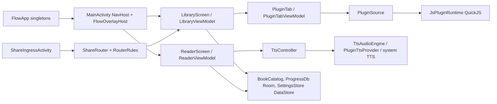

# Runtime shape

`FlowApp` owns the singletons: `db`, `settings`, `tts`, `catalog`, `pluginManager`, `pluginBooks`,
`pluginRepos`, `pluginInstaller`, `appScope`. ViewModels reach them via the application.
Routes and Back behavior: [navigation.md](../navigation.md).

## Repos

| Repo | Role |
| --- | --- |
| `flow-reader` (this) | Android app, plugin contract (`docs/plugins/`) |
| `../flow-reader-plugins` | Public plugin sources, Node test host, index build, Pages publish |
| `../flow-reader-chats` | Private: workflow stages, area history, decisions, transcripts |
