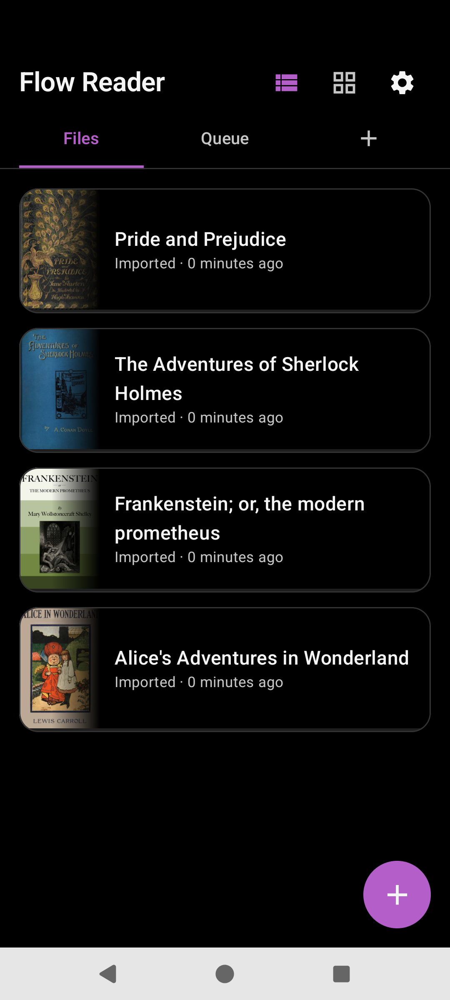
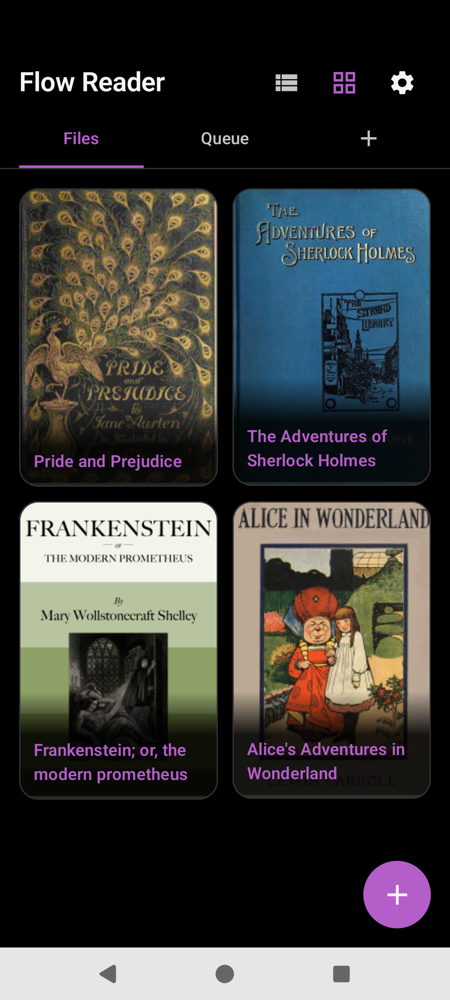
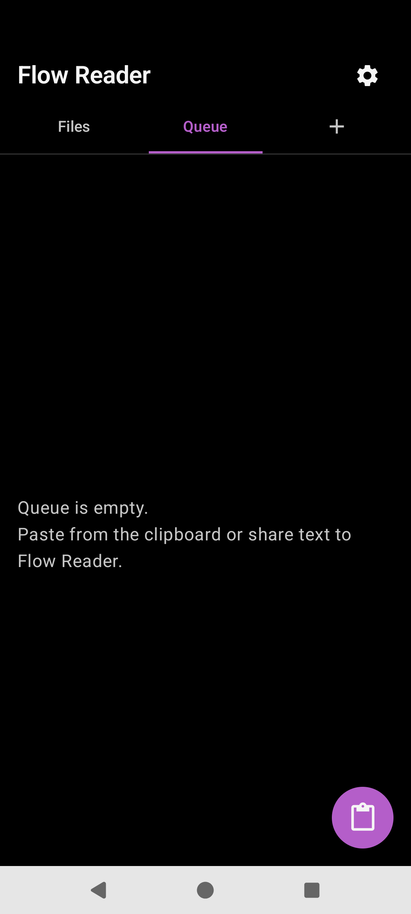
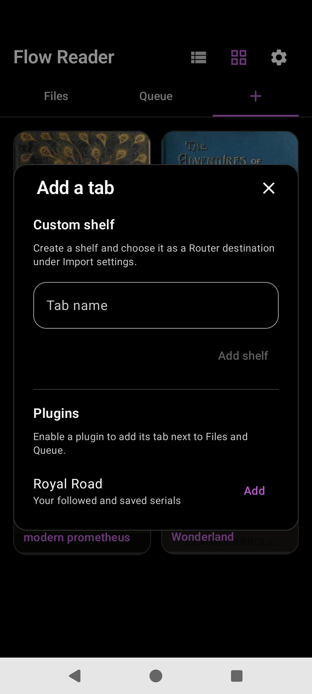

# Library

Home screen: tabs for **Files**, **Queue**, optional custom shelves and plugins, plus **+** to add a tab.

## UI map — header

| Control | Action |
|---------|--------|
| Title “Flow Reader › *tab*” | Brand, then the current tab's name (muted) |
| Settings gear | Opens Settings overlay. List rows vs cover grid is Settings › Layout › UI › Library view (`library_view`) |
| Tabs: Files, Queue, …, **+** | Select tab; **+** opens “Add a tab”. Settings › Layout › UI › Library tabs = Text shows names instead of icons (plugin sub-tabs too). Files (books) and Queue (layer stack) are icons; plugins show their packaged `icon.png` silhouette in the same tint (name when the plugin ships none); shelves stay text. Long-press an icon for its name. A plugin tab shows an accent dot while any of its stories has new chapters |

Tabs are a `Primary` `FlowTabBar`; **+** is its trailing action tab. The screen is a
`FlowScreen(Library)`: FAB per tab, snackbar above the FAB, cards stack in the window overlay.

## Now playing (bottom dock)

While a TTS session is active, a floating **Now playing** card sits in the bottom dock: title and
current sentence snippet. Playback keeps running after leaving the reader, and the card stays while
paused (`TtsUiState.sessionActive`).

| Control | Action |
|---------|--------|
| Card body | Open the reader at that book; playback continues uninterrupted at the spoken sentence |
| Play / Pause | Toggle playback without leaving the library |
| X | Stop playback (ends the session and the media notification) and close the card |

The session also ends on notification Stop, end of book, or a playback error. Plugin stories keep
playing only through chapters already loaded; streaming the next chapter needs the reader open.
Lists pad by the dock height, so the card never covers the last row.

## Files

| Element | Behavior |
|---------|----------|
| Empty copy | “No books yet…” |
| Book card tap | Files splash (media card): rail Share / Remove / Folder / Contents; footer **Read** |
| Double-tap | Open `reader/{id}` |
| FAB **+** “Add file” | “Add a book” → Import a copy / Reference in place → system picker |
| Card layout | Title; author (or source · last read when author unknown); **Chapter n/total** chip (primary if unstarted, secondary if in progress, muted grey if complete). No **"N new"** chip on Files |
| Sort | Media-card-style circle above the FAB opens a compact **Sort** card: **Date added** (default, newest first), **Title**, **Author**; remembered per tab (`library_sort`). Custom shelves use the same modes |
| Link badge | Linked (in-place) files |
| Progress bar | Reading progress |

**Import a copy** stores the file under app storage. **Reference in place** keeps a persistable URI when the location allows it.

## Queue

| Element | Behavior |
|---------|----------|
| Empty copy | Paste or share text into Flow Reader |
| Row tap | Open the Queue stream (all rows as one document) at that row; Contents lists rows with their chapters nested, updates live, and has the same hold-to-edit (see [reader.md](reader.md#toc)) |
| Done label | Finished while listening |
| Expand chevron | Multi-chapter items (crawled pages, EPUBs, plugin stories) list their chapters under the row, read from local metadata. Tap a chapter to open the Queue stream at its start; chapters before the item's saved chapter (all, once Done) are dimmed. `QueueChapters.kt` |
| Hold a row | Edit mode (shared `EditableRuleList`, same as filter and Import lists): drag handles reorder (`sortOrder` rewritten on drop), checkboxes select, All/None, Delete with confirmation; Done or Back leaves |
| FAB paste | Clipboard → Import router |

Queue is for share/clipboard ingest and TTS auto-advance — not for dumping plugin stories.

Each Queue entry has its own row and reading position. Queuing a Files or plugin book copies its
position at that moment; after that, reading in the Queue and reading the original book move
independently. A shared item with Auto Play opens the Queue at that entry. Storage:
[data.md](data.md#room-flowdb).

## Add a tab

- **Custom shelf:** name field, “Add shelf”; shelves appear as Import Router destinations
- **Plugins:** installed plugins (e.g. Royal Road) — Add / Remove to show a library tab; install from Settings → Plugins ([plugins.md](plugins.md))

## Source

- [`LibraryScreen.kt`](../app/src/main/java/com/personal/flowreader/ui/library/LibraryScreen.kt)
- [`LibraryBookCards.kt`](../app/src/main/java/com/personal/flowreader/ui/library/LibraryBookCards.kt)
- [`LibraryViewModel.kt`](../app/src/main/java/com/personal/flowreader/ui/library/LibraryViewModel.kt)
- [`FilesBookSplash.kt`](../app/src/main/java/com/personal/flowreader/ui/library/FilesBookSplash.kt) (`FlowMediaCard` + `FileMediaCardAdapter`)
- [`NowPlayingCard.kt`](../app/src/main/java/com/personal/flowreader/ui/library/NowPlayingCard.kt)
- UI components: [UI system](ui-system/README.md)

[Back to hub](README.md)
