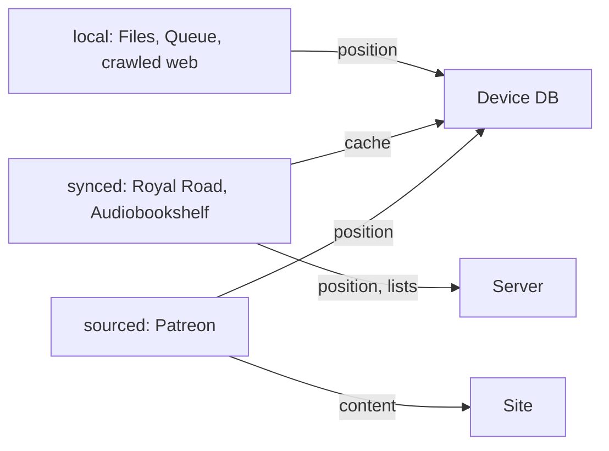

# Source kinds (design)

Status: **design, not implemented.** Today the host infers behaviour from capabilities
(`progressSync`, `membership`) and per-list `syncable`. This page names the categories those
combinations already form, fixes the rules for each, and plans the manifest field and the
Audiobookshelf plugin. Code lands in later tasks (see [Implementation order](#implementation-order)).

## Kinds

| Kind | Examples | Content comes from | Reading position lives | Position authority | Lists |
| --- | --- | --- | --- | --- | --- |
| `local` | Files tab, Queue, crawled web pages | A file on the device | App DB (`library_books`, `queue_items`) | Device | Shelves only |
| `synced` | Royal Road, Audiobookshelf (planned) | Server, cached on device | Plugin DB + server | Server (see conflicts) | Two-way with the site (`syncable` lists) |
| `sourced` | Patreon | Server, cached on device | Plugin DB only | Device | Local (`syncable: false`); site-derived browse lists are read-only |

`local` is host-only: plugins are always `synced` or `sourced`.



## Manifest

```json
{ "category": "synced" }
```

- Key `category` (`"synced"` or `"sourced"`), optional. Missing: `synced` when `capabilities`
  has `progressSync`, else `sourced`. Every published plugin is already correct without the key.
- Validation (host and `build-index`): `synced` requires `progressSync`; `sourced` must not declare
  it. A list may be `syncable` only in a `synced` plugin.
- `progressSync` stays as the capability for the functions (`syncProgress`, `readPositions`);
  `category` is the user-facing promise. Per-list `syncable` stays.
- Not named `sourceKind`: `LibraryBookEntity.sourceKind` / `QueueItemEntity.sourceKind` already mean
  "BookSource name or plugin id". Kotlin: `enum class SourceCategory { Local, Synced, Sourced }`,
  `PluginManifest.category`.
- Adding an optional key with a derived default is not a contract break; it ships with the next
  `apiVersion` bump rather than forcing one.

## Rules per kind

| Rule | `local` | `synced` | `sourced` |
| --- | --- | --- | --- |
| Position conflict | None: one device, `ProgressWriter` session rules | Three-way merge against the last synced state. Only one side moved: that side wins (site → device pull, device → site push). Both moved: **Position conflict** card (Use {site} / Keep mine / Later), site first | None: the site never stores position |
| Lists | Shelves | Three-way merge with removal guard ([two-way sync](../plugins.md#two-way-sync)) | Local only; never pushed |
| Offline | Everything works | Cached chapters read; list toggles and position pushes queue in `sync.json`; ToC refresh, new chapters and uncached chapters need network | Cached chapters read; uncached chapters and refresh need network; nothing to queue |
| Delete data | Remove deletes the imported copy (Linked: the reference only) | Local copies, positions, sync state, sign-in; site unchanged. Deleting a story also removes it from site lists | Local copies and positions. **Positions are gone for good** (no server copy): the confirm card says so |
| New chapters | n/a | `+N` badge; bell notifies | `+N` badge; bell notifies |
| Backup | App DB backed up | Plugin DB backed up; `files/plugins/` excluded (re-downloadable) | Same as synced; the plugin DB is the only copy of positions, so it must stay in backup |
| Row indicator | None (Linked keeps its corner link) | Corner `Icons.Filled.Sync`; `CloudUpload` while pushes are queued; conflict badge as today | Corner `Icons.Filled.Language` (web source, device position) |

Indicators use `FlowCornerBadge` on display cards (rows and tiles) with a `contentDescription`
("Synced with {site}", "From {site}, progress on this device"). The media card status line repeats
it in words.

## Audiobookshelf (planned `synced` plugin)

Scoped as its own task. What it needs from the host:

- **Time positions.** Audiobooks are positioned in seconds, not chapters/blocks. Add
  `ReadingPosition.timeMs: Long = 0` and `durationMs: Long = 0` (Room migration). `fraction`
  = `timeMs / durationMs`. Text books keep `timeMs = 0`.
- **Server API.** Progress per library item: `GET /api/me/progress/{itemId}` and
  `PATCH /api/me/progress/{itemId}` with `currentTime`, `duration`, `progress`, `isFinished`; the
  server's `lastUpdate` timestamp lets the merge compare sides without a prompt when only one moved.
  Ebooks in Audiobookshelf report `ebookLocation` (EPUB CFI) and `ebookProgress`; a CFI maps to
  `chapterHref` + block, so text ebooks fit the existing position model.
- **User-set host.** Audiobookshelf is self-hosted; `allowedHosts` is static today. Needs a host API
  addition: a manifest `serverSetting` naming the settings key whose URL is added to the allowed
  hosts at runtime (cross-repo change, [cross-repo.md](../agent/cross-repo.md)).
- **Auth.** API token field (`auth.fields`, `secret: true`), sent as `Authorization: Bearer`.
- **Playback.** Audiobook files need a media player (Media3/ExoPlayer) beside TTS; the reader
  stays for ebooks. This is the bulk of the work and is out of scope for the source-kind change.

## Implementation order

1. `SourceCategory` + `PluginManifest.category` (derived), validation in the host and
   `scripts/build-index.mjs`; schema and [api-manifest.md](api-manifest.md).
2. Row indicator (`FlowCornerBadge` per kind) and the media card status line.
3. Delete-data confirm text per kind (sourced: positions lost).
4. Audiobookshelf: `timeMs`/`durationMs` migration, user-set host, then the plugin and player.

Decision log: the private context repo's `decisions/plugins.md` (2026-10-11).
