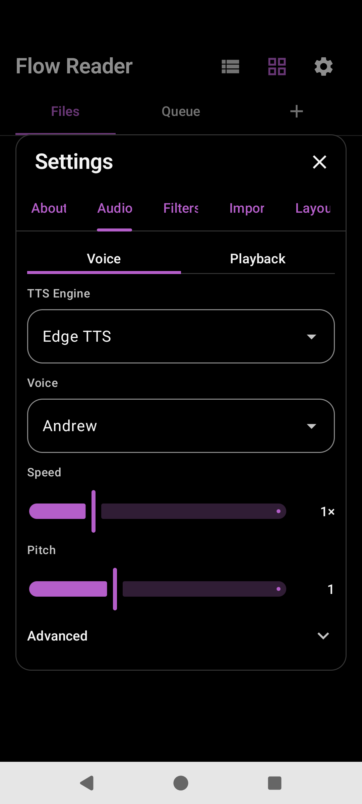

# TTS

Listen while reading. Engines and voices live under Settings → **Audio**; the reader media card and gestures control playback.

## Engines

- **Default (system TTS)** / other installed Android TTS engines — on-device speech.
- **TTS plugins** (e.g. **Edge TTS** when the `edgetts` plugin is installed) — clip MP3 cache,
  prefetch, and optional word boundaries. Engine key `tts:{pluginId}`. Edge uses Microsoft Read
  Aloud (`api.msedgeservices.com`) with Sec-MS-GEC **v2**; see [plugins/api-tts.md](plugins/api-tts.md).
  Language then Voice filters the plugin catalog. Sentence splitting is tuned for English.

Priority goals: stability → latency → footprint.

## Playback behavior

| Feature | Notes |
|---------|--------|
| Sentence highlight | Always |
| Word highlight | When engine provides boundaries |
| Auto-scroll | Follows playhead when enabled |
| Scroll lock | Forces follow; double-tap to unlock |
| Pin card | When playhead leaves the viewport |
| Margin rail | Cache / loading indicators for Edge clips |
| Media session | Notification + background keep-alive via `TtsPlaybackService` |
| Interruptions | Audio focus (`FocusResume`). Transient loss (alarm, call, nav prompt; duck requests too, since speech pauses rather than ducks) pauses and resumes on focus gain if the break lasted ≤ 5 min (`FOCUS_RESUME_MAX_MS`); longer breaks stay paused. Any user play/pause/stop in between cancels the resume. Permanent loss (another media app) pauses with no resume; the next Play requests focus again. Resume restarts the current sentence. Debug log: `focus loss transient`, `focus gain resume after Ns`, `focus gain no-resume …`, `focus loss permanent` |
| Tonal underlay | Quiet noise while playing. Mode toggle Off / Auto / On; Auto sounds only while playback is routed to the picked paired device (media output route: `getAudioDevicesForAttributes` on API 33+, else the playing track's routed device), not merely connected; re-checked on play, track route changes, device add/remove and Bluetooth broadcasts. |
| Auto Play on Share | Settings → Import → Router. Off by default. Text, file and web-page shares (`LibraryViewModel.executeShareIntent`) open the saved book in the reader and call `play()` once it loads (`FlowApp.pendingSharePlay`), only when nothing is playing unless **Interrupt Playback** is on. Plugin links, clipboard paste and "Open with" are unchanged |

## Chapters and documents

- Entering a chapter loads the chapters on either side (local files and plugin streams alike), so
  crossing a chapter boundary doesn't wait on a load. Empty chapters are skipped; a load error
  ends playback and is logged (`pullMore failed`).
- Plugin chapters fetched by the reader window, TTS and cache upkeep share one fetch per chapter.
  Each spoken chapter change also downloads the story's cache level of chapters ahead (see
  [plugins.md](plugins.md)).

## Queue stream

The Queue is read as one document: every row in Queue order (done ones too) joined into one
composite book (`QueueBook`, session id `queue`, built by `QueueStreams`). Scrolling and TTS run
from one item into the next with no break, with the reader open or closed. When playback moves on
from item N to item N+1, `QueuePlayback` marks N done; the end of the stream marks the last item
done. `QueuePlayback` also watches `queue_items`: rows appended at the end and Done changes are
swapped into the open session (TTS keeps playing and reads on into new rows); reordered or removed
rows rebuild the session at the spoken text and re-attach TTS (the current sentence restarts once).
Positions are stored per Queue entry (the locator maps the stream position back to the entry's own
chapter, block and progress fraction and writes its `queue_items` row, never the Library or plugin
copy of the same book), so the Queue tab keeps its progress bars.

Known limits: TTS-only Local filters come from the item the stream was opened on; the first open
of an item in the stream synthesizes fresh clips (cache key is the stream, not the book).

## Unspeakable sentences

- Text with no letters or digits after TTS-only filters (scene breaks like `* * *`, lone
  punctuation, text a filter emptied) is skipped silently; with debug on, the log gets a
  `skip i=… nothing to say` line.
- Edge rejecting a sentence (`EdgeContentException`: nothing to synthesize, too long, no audio
  returned) skips it and keeps playing: debug turns on, the log records
  `ERROR skipped i=…: <reason> text="…" spoken="…"`, and the log panel opens.
- Network failures pause on the current sentence instead of stopping (see below). Other failures
  still stop playback (logged as `ERROR`).
- A failed lookahead clip isn't retried by prefetch; the playhead retries or skips it when it gets
  there. Characters XML forbids (control chars, lone surrogates) are stripped before Edge SSML.

## Clip-audio plugins and networks

- **Edge TTS** lives in `flow-reader-plugins/EdgeTts` (`kind: "tts"`, engine `tts:edgetts`). The
  plugin owns Sec-MS-GEC **v2** and opens WSS via `flow.ws.collect` (see
  [plugins/api-tts.md](plugins/api-tts.md)). Voice catalog:
  `api.msedgeservices.com/.../voices/list` with v2 GEC (key-only → 403); falls back to Bing
  `voices/list` if needed. Settings Voice list is always the selected engine’s catalog, then
  Language, then optional All/Male/Female (from `gender` on voice entries). The app owns clip
  cache, prefetch, word highlight, and `TtsAudioEngine` playback.
- **Upstream:** [Readest `edgeTTS.ts`](https://github.com/readest/readest/blob/main/apps/readest-app/src/libs/edgeTTS.ts)
  is the source of truth for GEC, URL, headers, and framing; host `PluginWs` follows Readest’s
  [raw-socket upgrade](https://github.com/readest/readest/blob/main/apps/readest-app/src/libs/workersWebSocket.ts)
  (OkHttp’s WebSocket upgrade gets HTTP 200 from Edge). Port Readest; do not invent a parallel
  handshake. Cursor rule: `flow-reader-plugins/.cursor/rules/edgetts.mdc`.

- **Synth path:** host calls `provider.synthesize` once per clip (single-shot). Host still keeps
  `RaceSchedule` / `NetworkLanePolicy` / `EdgeNetwork` for offline wait and the mobile-data setting
  when the provider advertises `networkLanes`; multi-attempt race/hedge over plugin synth is not
  wired yet (ask before reintroducing).
- Setting **Use mobile data when Wi-Fi is weak** (Playback tab) shows only for `networkLanes`
  providers. Voice **Advanced** (prefetch / clip size) shows only for clip-audio / prefetch
  providers.
- **Network failure at the playhead** (`EdgeNetworkException`): logged as `ERROR network …`,
  playback waits until a network is usable, backs off 1/2/4/8 s, clears failed lookahead, and
  retries. Session and media card stay up.
- Synth log lines use `tts synth[…]` (source `pre` / `play` / `next` / `regen` / `preview`).

## Debug

About → Debug mode shows the bug bubble. About → Debug → **TTS Synthesis** gates synth/engine
lines in the Debug log (`FlowReader.Tts`).

## Source

- [`tts/`](../app/src/main/java/com/personal/flowreader/tts/)
- [`tts/provider/`](../app/src/main/java/com/personal/flowreader/tts/provider/)
- [`TtsPlaybackService.kt`](../app/src/main/java/com/personal/flowreader/tts/TtsPlaybackService.kt)
- [`AudioSettings.kt`](../app/src/main/java/com/personal/flowreader/ui/settings/AudioSettings.kt)
- Plugins: `../flow-reader-plugins/EdgeTts/`

[Back to hub](README.md)
